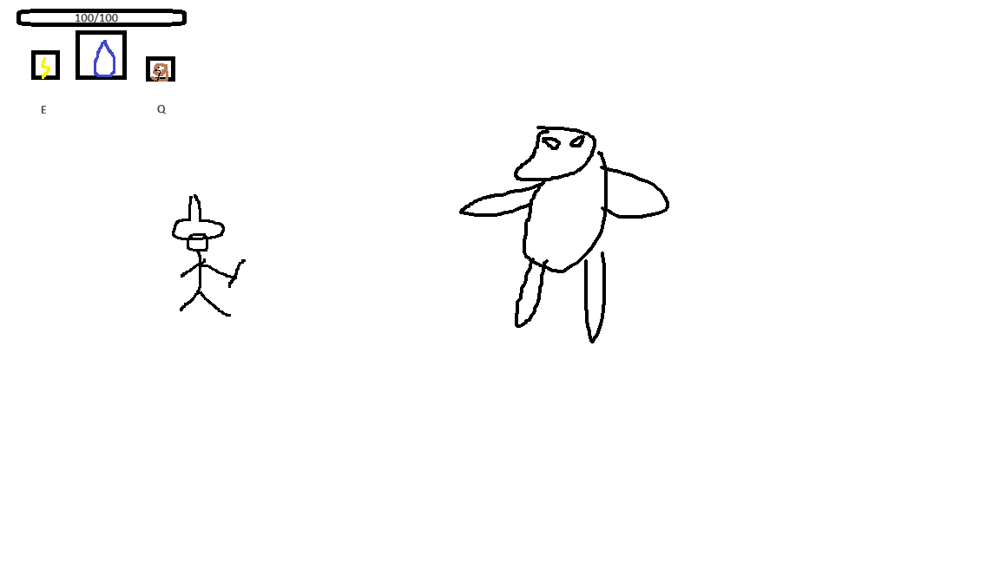
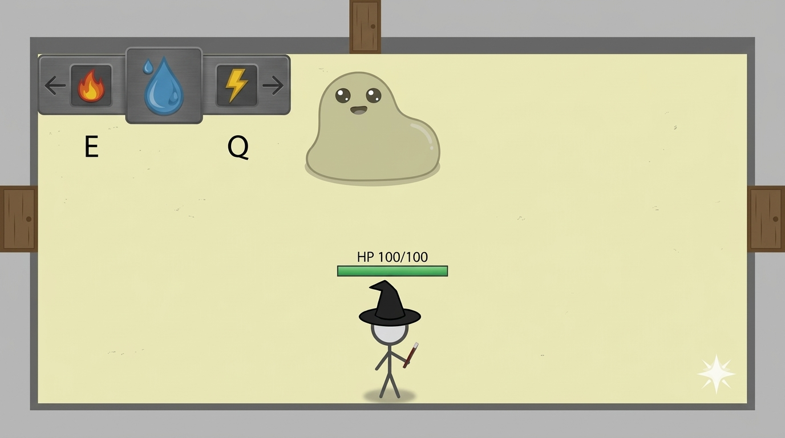

# 📝 게임 기획서

### 3주차 · 보완한 기획서

`WEEK 03` · `기획서 피드백 및 구체화` · `성과물: 보완한 게임 기획서`

2주차 기획서를 Gemini 점검과 튜팅 피드백으로 보완해서 다시 정리합니다. 위쪽 **🤖 Gemini와 기획서 보완하기**를 이용하면 Gemini와 정리한 내용을 이 양식에 바로 채울 수 있어요.

> ✏️ **작성 방법:** 오른쪽 위 연필 ✏️ 아이콘을 누르고 빈칸에 내용을 적은 다음 **Commit changes**를 누르세요.

---

## 1️⃣ 이 게임을 한 문장으로 소개하기

> 예: 고양이가 떨어지는 생선을 받고 폭탄은 피하며 최대한 오래 버티는 게임

**답:** 마법사인 플레이어가 단계를 넘어갈 때마다 능력을 얻을 수 있고 적이 강해지는 액션 게임

## 2️⃣ 타깃 플레이어

> 이 게임을 누가 할지 적습니다. 아직 못 정했으면 빈칸으로 둡니다.

**답:** 액션 로그라이크를 좋아하는 사람들

## 3️⃣ 레퍼런스 게임 (2~3개)

| 🎮 게임 이름 | 🏷️ 장르 | 👀 참고하고 싶은 점 |
|---|---|---|
| Hades | 액션 로그라이크 | 참고하고 싶은 점: 게임 시작전 고를 수 있는 다양한 무기와 게임 시작 후 얻을 수 있는 다양한 능력 |
| Isaac | 로그라이크, 액션, 어드벤쳐 | 많은 보스와 눈물로 공격을 한다는 독특한 아이디어 |
|  |  |  |

## 4️⃣ 핵심 요소

> 이 게임에서 가장 중요한 재미 요소는 무엇인가요?

**답:** 스테이지를 클리어 할수록 강해지는 플레이어와 몬스터들을 처리해 나가는 재미

---

## 5️⃣ 스테이지 1 만들어 보기

> 📌 게임 전체가 아니라 **첫 번째 스테이지 하나만** 생각합니다. 스테이지 1을 만들려면 무엇이 필요한지 적어 봅니다.

### 5-1. 스테이지 1에서 일어나는 일

| 구분 | 내 게임에서는 |
|---|---|
| ▶️ **시작할 때** | 캐릭터가 특정 마법 속성을 가지고 첫번째 스테이지에서 서있다 |
| 🔄 **플레이 중** | 스테이지 클리어 시 다른 방으로 갈 수 있는 문이 여러개 있다. (방의 모든 몬스터 처치 시 보상과 함께 문이 자동으로 열림, 방 5개 클리어 후 6번째 방에 보스 방 문 등장) |
| 🏆 **클리어 조건** | 일반 방 5개 클리어 후 6번째 보스 방의 보스를 쓰러뜨리기 |
| 💥 **실패 조건** | 플레이어의 Hp가 전부 소진시 사망 |

### 5-2. 스테이지 1에 등장하는 것들

게임 프로그램은 등장하는 것마다 **갖고 있는 정보**와 **하는 행동**으로 이루어집니다. 아래 표가 나중에 내 프로그램의 구조가 됩니다.

| 이름 | 갖고 있는 정보 (예: 위치, 목숨) | 하는 행동 또는 규칙 (예: 이동, 점프) |
|---|---|---|
| 🧍 **플레이어** | Hp 100 | 자유롭게 이동이 가능하며 공격을 할 수 있다. (기본 속성을 지니고 시작함) |
| 몬스터 | 특정 속성에 내성과 약점이 있다 | 플레이어를 발견시 플레이어를 쫓아온다 |
| 문 | 다음 방으로 넘어갈 수 있다 | 넘어간 방에는 몬스터 또는 보상이 있다 |
| 마법서 | 다른 속성의 마법이나 특정 속성의 마법의 스킬을 배울 수 있다 | 마법서가 나온 방은 몬스터가 나오지 않는다 |

> 플레이어 외에 몬스터, 퍼즐, 아이템, 장애물 등 스테이지 1에 꼭 필요한 것만 적습니다. 부족하면 같은 모양으로 줄을 더 추가해도 돼요.

### 5-3. 입력 방식

> 사용할 입력 방식의 `[ ]`를 `[x]`로 바꾸고, 어떤 입력이 어떤 동작이 되는지 적습니다.

- [x] ⌨️ 키보드
- [x] 🖱️ 마우스

| 입력 | 게임 속 동작 |
|---|---|
| 예: 스페이스 키 | 점프 |
| w,a,s,d | 이동 |
| space | 대쉬 |
| 마우스 좌클릭, 우클릭 | 마법 공격 |

### 5-4. 화면 시점

> 탑다운 / 사이드뷰 / 세로 스크롤 / 고정 한 화면 / 쿼터뷰 / 3D 중 하나와 이유를 적습니다.

**답:** 탑다운 / 레퍼런스 게임(하데스, 아이작)의 장르적 특성과 360도 마우스 조작 및 적 위치 파악이 용이함

---

## 7️⃣ 스테이지 1 화면 그림

> 그림판이나 종이에 그린 스테이지 1 화면과, 그 그림으로 Gemini에게 받은 목업을 올립니다.

**✏️ 내 손그림**

**🖼️ Gemini 목업**

---

🛠️ 4주차에는 이 기획서로 구성요소를 하나씩 만들어요!

